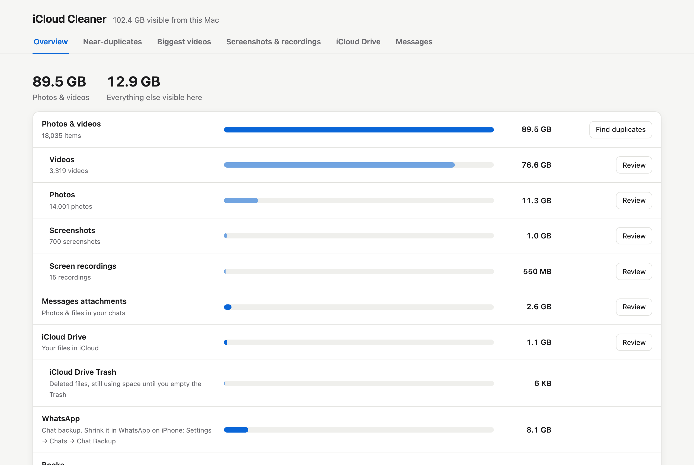

# iCloud Cleaner

A local web page that shows what fills your iCloud and lets you delete what you pick. It runs only on your Mac, and nothing is uploaded.



## What it shows

- **Overview:** space used by Photos, iCloud Drive, Messages attachments and app data in iCloud.
- **Near-duplicates:** similar photos taken within a minute of each other. The best shot in each group is kept and the rest are pre-selected.
- **Biggest videos** and **Screenshots & recordings**, largest first.
- **iCloud Drive:** your largest files.
- **Messages:** your largest attachments and the chat each one came from. You can only view these here, not delete them.

Nothing is permanently deleted:
- Photos go to **Recently Deleted** in Photos, and macOS asks you to confirm first.
- iCloud Drive files go to the **Trash**, where Put Back still works.

iCloud frees the space once you empty Recently Deleted or the Trash.

## Requirements

- macOS 13 or later (tested on macOS 26), with your library in the default `~/Pictures/Photos Library.photoslibrary`. The app reads Apple's private Photos and Messages databases, which can change between macOS versions.
- Python 3.7+ (standard library only, no `pip install`)
- Xcode Command Line Tools, used to build the small Swift helper on first run

## Set up with Claude Code or Codex

Paste this into Claude Code or Codex:

```text
Clone https://github.com/mic2112/icloud-scanner, then set up iCloud Cleaner by following
.claude/skills/setup-icloud-cleaner/SKILL.md in that repo.
```

The agent runs the setup check, installs what's missing, opens the right System Settings panes for you, and starts the app. Inside the repo, Claude Code also finds the skill by itself: just ask it to "set up iCloud Cleaner".

## Set up by hand

1. Install the Command Line Tools, if you don't have them:
   ```sh
   xcode-select --install
   ```
2. Clone the repo:
   ```sh
   git clone https://github.com/mic2112/icloud-scanner.git
   cd icloud-scanner
   ```
3. Give your terminal app (Terminal, iTerm, VS Code...) **Full Disk Access**: System Settings → Privacy & Security → Full Disk Access. Without it, the app can't read your Photos library or your Messages history. Quit the terminal with ⌘Q and reopen it afterwards.
4. Check everything is ready:
   ```sh
   python3 cleaner.py --check
   ```
   Each line says `ok`, or `FIX` with the exact fix underneath.

If you skip a permission, the app shows a pop-up explaining how to turn it on, with a button that opens the right System Settings pane.

## Run

```sh
python3 cleaner.py
```

The first run builds the `helper` binary, which takes about 30 seconds. After that, the page opens in your browser at `http://127.0.0.1:<random port>/`. Press Ctrl+C in the terminal to stop it.

The first time you delete photos, macOS asks for **Photos** access. Click Allow. If you click Don't Allow, the app shows how to turn it back on.

### Options

| Flag | What it does |
|------|--------------|
| `--no-open` | Start the server without opening a browser |
| `--check` | Check macOS, tools and permissions, print the fix for anything missing, and exit |
| `--selftest` | Run the built-in checks and exit |

## Notes

- **First scan:** the near-duplicate scan takes a few minutes. The results are saved in `.cache/`, so later runs are fast.
- **Privacy:** `.cache/` holds thumbnails and IDs from your own library. It is gitignored, and you can delete it at any time.
- **Network:** the server only listens on `127.0.0.1`, and any action that changes something needs a token that is new each run.
- **Not covered:** iPhone backups, Mail and Notes can't be read from a Mac. Use the "Open iCloud settings" button on the Overview tab to check them.

## Files

| File | Purpose |
|------|---------|
| `cleaner.py` | Local server: reads Photos, Messages and iCloud Drive, and serves the page |
| `index.html` | The web page |
| `helper.swift` | Native helper that compares photos (Vision), deletes photos (PhotoKit) and moves files to the Trash |
| `Info.plist` | Gives the helper its Photos permission prompt |
| `.claude/skills/setup-icloud-cleaner/` | Setup skill for Claude Code; `AGENTS.md` points Codex at it |
